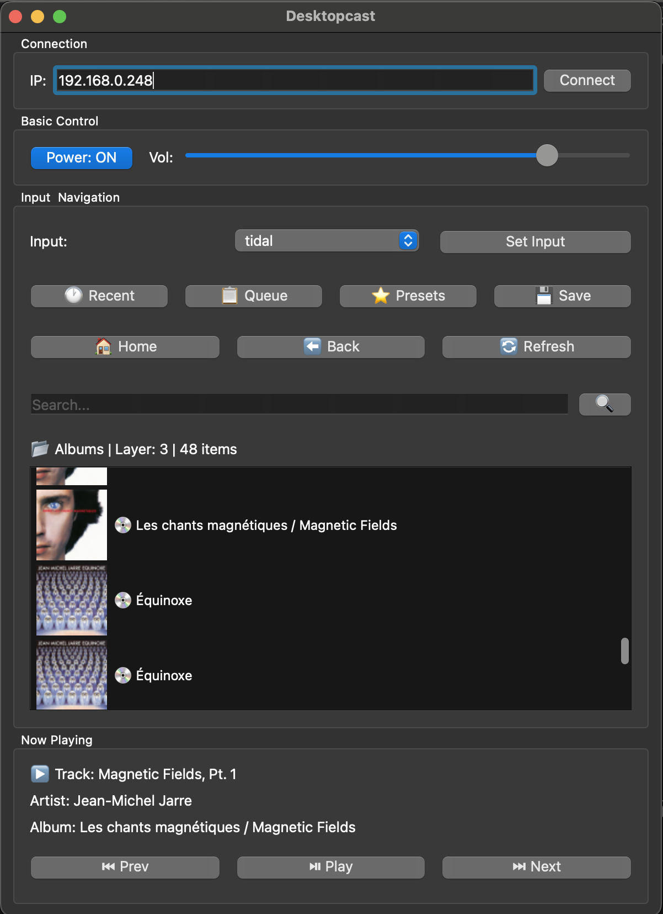

# 🎵 Desktopcast

<p align="center">
  
  
  
  
</p>

<p align="center">
  <strong>A beautiful desktop application for controlling Yamaha MusicCast receivers</strong>
</p>

<p align="center">
  Browse Tidal, Spotify, and more directly from your desktop. Control volume, playback, and navigate your music library with ease.
</p>

---

## 💡 Why Desktopcast?

While Tidal and other streaming apps offer "Connect" features for Yamaha receivers, **many older MusicCast receivers are no longer supported** — leaving users without a proper desktop app to browse and control their music.

Some third-party solutions exist, but they're often paid, closed-source, or limited in functionality. **I believe there should be a free, open-source option available to everyone.**

Desktopcast is my answer to this problem: a lightweight, open-source desktop controller that works with any Yamaha receiver supporting the MusicCast/YXC API — no matter how old.

---

## ✨ Features

- 🎛️ **Full Receiver Control** - Power, mute, and input selection
- 🔊 **Volume in dB** - Live slider with a dB scale (as on the receiver's display), −/+ buttons, and a ramp that stops a stray click from jumping to full volume
- 🎵 **Music Browsing** - Navigate Tidal, Spotify, Deezer, Qobuz, and more
- 🔍 **Search** - Search your streaming services directly
- 🎶 **Playlist Mode** - The queue beside the browser: double-click songs, albums or playlists to add them; play, skip or remove entries; "Play now" without losing the playlist
- 🕐 **Recent Items** - Quick access to recently played content
- ⭐ **Presets** - Save and recall your favorite stations/playlists
- 🖼️ **Album Art** - Beautiful thumbnail display for your music
- 📡 **Remembered Receivers** - Reconnects to the last receiver at startup; each receiver is listed by room name and model
- 🧩 **Adapts to your model** - Lists the receiver's own inputs (HDMI and tuner on an AV receiver, its own streaming services) and checks whether it has a play queue; Playlist Mode is only offered where it works, and ⚙ lets you override that per receiver
- 🔄 **Live Updates** - The receiver pushes changes (volume, track, play time) to the app, with polling as a fallback

## 📸 Screenshots



## ⚠️ Current Status

> **Note:** This project is in active development.

- ✅ **Tested on:** Yamaha R-N602 (has a model profile: dB volume scale and tested queue editing)
- 🧩 **Other models:** the app detects what your receiver supports when it connects. Older models (e.g. RX-V receivers that got MusicCast through a firmware update) may have no play queue: then double-click plays songs directly and Playlist Mode is switched off
- ⚠️ **Streaming services:** Tidal is fully functional; other services (Spotify, Deezer, Qobuz, etc.) may have limited functionality
- 🔄 **Coming soon:** Support for additional Yamaha models and potentially other receiver brands

If you have a different Yamaha model and want to help test, please [open an issue](https://github.com/incubodac/Desktopcast/issues) with your model name and what works or not. Click **⚙ → Copy receiver details** and paste the result in the issue: it shows what your receiver supports (its device IDs and network details are left out).

## 🚀 Installation

### Prerequisites

- Python 3.9 or higher
- A Yamaha receiver with MusicCast/YXC support
- Your receiver's IP address (find it in your router or receiver's network settings)

### Option 1: Install from source

```bash
# Clone the repository
git clone https://github.com/incubodac/Desktopcast.git
cd Desktopcast

# Create a virtual environment (recommended)
python -m venv venv

# Activate it (use the line for your shell)
source venv/bin/activate           # bash / zsh
# source venv/bin/activate.fish    # fish
# source venv/bin/activate.csh     # csh / tcsh
# venv\Scripts\activate            # Windows

# Install dependencies
pip install -r requirements.txt

# Run the application
python main.py
```

> **Tip:** If you'd rather not activate the venv, call its interpreter directly:
> `./venv/bin/pip install -r requirements.txt` and `./venv/bin/python main.py`
> (on Windows: `venv\Scripts\pip` and `venv\Scripts\python`).

### Option 2: Download release (coming soon)

Pre-built binaries for Windows, macOS, and Linux will be available in the [Releases](https://github.com/incubodac/Desktopcast/releases) section.

## 🎮 Usage

1. **Connect to your receiver**
   - Enter your Yamaha receiver's IP address
   - Click "Connect"
   - Next time the app reconnects by itself; other receivers you used are in the dropdown
   - ⚙ holds options for the connected receiver (see [Configuration](#-configuration))

2. **Control playback**
   - Use the transport controls (play, pause, previous, next)
   - Adjust volume with the slider (drag, click, mouse wheel or arrow keys), the −/+ buttons, or mute

3. **Browse your music**
   - Select an input source (Tidal, Spotify, etc.)
   - Navigate through menus by clicking items
   - Use the search function to find specific content
   - Right-click an item for more: add to playlist, play next, play now, open

4. **Manage your queue**
   - Click "Playlist Mode" to show the queue beside the browser
   - Double-click a song, album or playlist to add it; double-click a queue entry to play it
   - Songs in search results can't be queued by the receiver itself, so the app finds the same song in the artist's top tracks or in its album (matched by the album cover) and adds that one. This takes a few seconds; the status line shows where it was found
   - Outside Playlist Mode, double-click plays a song right away through the queue (it's inserted after the current song), so the queue is kept. Only what the queue can't hold (radio, recent items, presets, a song the app can't find in an album) plays straight from the list; the receiver then drops its queue, so the app asks first
   - Select entries (Shift/Cmd-click for several) and press Delete or "Remove" to take them out; "🧹 Clear" empties the whole queue
   - The receiver's queue holds at most 200 tracks (adding a long Tidal playlist fills it). When it's full the app says so instead of adding
   - If the receiver wipes the queue, the panel says so and shows the last command sent before it
   - Use "Recent" for recently played items
   - Save favorites to presets (the first empty slot; existing presets are never overwritten)

## 🔧 Configuration

The first time, the receiver field suggests `192.168.0.248`. After a successful connection the receiver is remembered (by its device ID, so a new IP from your router updates the same entry).

The app asks the receiver to push changes to it over UDP. If your firewall asks whether Python may accept incoming connections, allowing it makes updates instant; if you deny it, the app falls back to polling.

**Per-receiver options (⚙ next to Connect):**
- **Play queue / Playlist Mode:** *Auto* uses what was detected when connecting (the app asks the receiver for its queue; a receiver that doesn't know the command has none). *Always on* tries the queue features anyway; *Off* makes double-click play songs directly, like on a receiver without a queue. Choosing *Auto* again re-checks the receiver.
- **Copy receiver details:** model, firmware, features and what was detected, to paste in a bug report.

Options are remembered per receiver, together with the last detection result (used if the receiver doesn't answer the check next time). They are stored with the remembered receivers, by device ID, so they survive a new IP address. The storage is the OS's usual place: `~/Library/Preferences/com.desktopcast.Desktopcast.plist` on macOS, the registry under `HKEY_CURRENT_USER\Software\Desktopcast\Desktopcast` on Windows, `~/.config/Desktopcast/Desktopcast.conf` on Linux.

**Inputs:** the input list is the receiver's own. Inputs without menus (HDMI, tuner, AirPlay...) can be selected; the browser then says there's nothing to browse.

**Model profiles:** `MODEL_PROFILES` in `main.py` holds per-model settings (dB scale, loud zone, tested features). The R-N602 doesn't report volume in dB, so the app shows `−80.5 + 0.5 × volume` (volume 92 = −34.5 dB). Other models use the dB range the receiver reports, or the same Yamaha convention when the volume goes 0–161.

To enable debug output, set `DEBUG = True` in `main.py`.

## 📡 Supported Devices

This application works with Yamaha receivers that support the **Yamaha Extended Control (YXC) API**, including:

- Yamaha RX-V series
- Yamaha RX-A series  
- Yamaha WXA/WXC series
- Other MusicCast-enabled devices

## 🤝 Contributing

Contributions are welcome! Here's how you can help:

1. Fork the repository
2. Create a feature branch (`git checkout -b feature/amazing-feature`)
3. Commit your changes (`git commit -m 'Add amazing feature'`)
4. Push to the branch (`git push origin feature/amazing-feature`)
5. Open a Pull Request

Please read [CONTRIBUTING.md](CONTRIBUTING.md) for details on our code of conduct and the process for submitting pull requests.

## 📋 Roadmap

- [ ] Multi-room/zone support
- [ ] System tray integration
- [ ] Keyboard shortcuts
- [ ] Dark/light theme toggle
- [ ] Pre-built binaries for all platforms
- [ ] Auto-discovery of receivers on network

## 📄 License

This project is licensed under the MIT License - see the [LICENSE](LICENSE) file for details.

## 🙏 Acknowledgments

- Yamaha for the MusicCast API
- The PyQt team for the excellent GUI framework
- All contributors and users of this project

## 📬 Support

- 🐛 Found a bug? [Open an issue](https://github.com/incubodac/Desktopcast/issues)
- 💡 Have an idea? [Start a discussion](https://github.com/incubodac/Desktopcast/discussions)
- ⭐ Like this project? Give it a star!

---

<p align="center">
  Made with ❤️ for the MusicCast community
</p>
